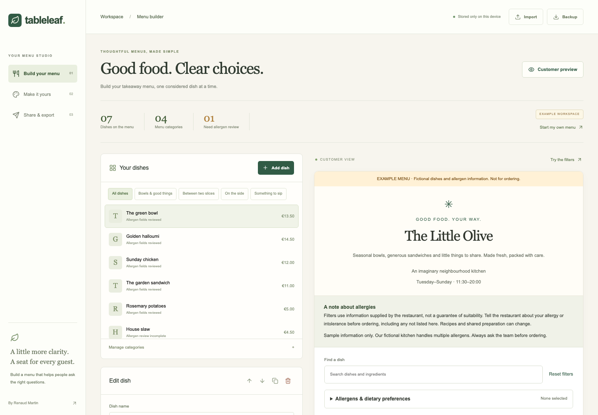

# Tableleaf

A takeaway-menu builder with ingredients, restaurant-declared allergen information, customer filters, branding, and portable exports.

**[Open Tableleaf](https://rjamartin.github.io/menu-builder/)** · [Portfolio](https://rjamartin.github.io/) · [Case study](docs/CASE_STUDY.md)

## Build a menu

1. Explore the fictional example, or choose **Start my own menu** for a blank restaurant workspace.
2. Add categories, dishes, descriptions, ingredients and prices. Hide unavailable dishes without deleting them. Unavailable recipes are omitted from published HTML and embeds, while editable JSON backups retain them.
3. Review each of the 14 EU allergen groups: **contains**, **may contain / shared preparation**, **reviewed: not present**, or **not reviewed**.
4. Add only dietary declarations the restaurant can substantiate for the finished dish. Gluten-free, dairy-free, vegetarian and vegan are separate fields.
5. Customize the restaurant name, introduction, logo, colour, typography, layout, contact information and collection hours.
6. Try the customer filters, then share or export.

Drafts are saved in this browser's localStorage after edits. Download a JSON backup to preserve an editable copy or move to another device. Storage errors are reported; a JSON file remains the portable source of truth.

## Customer filtering

Customers can select allergens to avoid, choose dietary preferences, search dishes/ingredients, and either highlight matches or show only matches. Their selections remain in the tab and are not saved or transmitted.

- A selected allergen marked **contains** or **may contain** is excluded from matches.
- **Not reviewed**, missing or unrecognised information is uncertain and never treated as absence.
- Every selected restriction must match. Allergen groups such as tree nuts and gluten-containing cereals are deliberately broad.
- Gluten-free and dairy-free require both an explicit dietary declaration and a compatible reviewed allergen state. Conflicting claims cannot be exported.
- Vegan does not imply milk-allergy suitability, and lactose-free is not treated as milk-allergen-free.
- Full ingredient, cross-contact and unknown information is visible in each dish's details.

**A match is not a guarantee that a customer can safely eat a dish.** All information is supplied by the restaurant. Every customer menu includes a reminder to discuss allergies, intolerances, ingredients outside the 14 groups, and shared preparation with staff. The application cannot verify recipes, supplier data, cross-contact controls or legal compliance.

Changing ingredients resets that dish's allergen and dietary reviews. Duplicating a dish also resets its reviews. The example contains synthetic declarations and is visibly labelled as fictional in all exports.

## Export and embed

- **Interactive HTML:** one self-contained file with the same filters and rules as the preview. No remote scripts, fonts, images or runtime libraries are needed. Host this file on the restaurant's website, or open it locally.
- **Print / PDF:** opens the complete menu with all ingredient and allergen details expanded. Choose a printer or **Save as PDF** in the browser. This is the full menu, independent of any preview filters.
- **Embed:** a self-contained `iframe srcdoc` snippet. Paste into a custom HTML block on a website that permits iframes and inline scripts. The frame is sandboxed without `allow-same-origin`; it scrolls internally with an adjustable height. Some CMS platforms remove `srcdoc` or scripts. On those platforms, host the exported HTML file and use the platform's supported iframe/URL embed feature instead.
- **JSON backup:** imports back into Tableleaf for future editing. HTML and PDF are publishing outputs, not editable backups.

Shared files and pasted embed code are snapshots. Re-export and replace them after updating recipes, allergen reviews or prices. There is no automatic publication, ordering, payment processing, account system or multi-device synchronization.

## Run

Node.js 22.12 or newer:

```sh
npm ci
npm run dev
```

```sh
npm test
npm run build
npm run preview
```

Development uses port 5182. Stop it before using the default preview on the same port. The build is static and uses relative assets for GitHub Pages. Run **Actions → Deploy to GitHub Pages → Run workflow** on `main` to publish. CI runs tests and a production build on pushes and pull requests.

## Architecture

- `src/App.tsx`: restaurant workspace, local drafts, dish/category editing, branding and export controls.
- `src/engine.ts`: typed menu model, conservative matching rules, validation, sample data and defensive import.
- `src/viewer.ts`: framework-free customer renderer, used unchanged in the live preview and portable exports.
- `src/export.ts`: self-contained HTML, printable output, and escaped sandboxed iframe code.
- `src/guest.css`: portable customer-menu styles, responsive layout and print formatting.

React manages the editor. Customer exports use native HTML, CSS and JavaScript and do not depend on React. The engine factory and viewer are self-contained functions serialized into the HTML. Tests and production-browser checks verify this boundary, including escaped user content and iframe execution.

## Bounds and scope

- One restaurant/menu per workspace, 1–20 categories and up to 100 dishes.
- EUR, GBP, USD and CAD; prices up to six digits and two decimals. A comma decimal separator is accepted.
- JSON import is limited to 2 MB and validated before replacing the current workspace.
- Logos accept PNG, JPEG or WebP up to 2 MB and 16 megapixels; they are resized to a 320-pixel maximum side and embedded locally.
- No ingredient-based allergen inference, ingredient inventory, nutritional analysis, custom allergen taxonomy, translations or individually configured item modifiers.
- Broad allergen groups are conservative: this version does not model special regulatory exceptions for particular derivatives, such as specially processed wheat ingredients. Specify exact cereals/nuts in ingredients and consult the applicable rules.
- Browser print rendering varies. For long notes or dense menus, inspect the browser's print preview before distributing a PDF.

## References

The 14-group list and the distinction between allergen information and dietary claims were checked against the [European Commission's allergen guidance](https://food.ec.europa.eu/food-safety/campaign-2026/allergies_en), [gluten-free information](https://food.ec.europa.eu/food-safety/labelling-and-nutrition/specific-groups/gluten-free-food_en), and [Food Standards Agency guidance on precautionary information](https://www.food.gov.uk/business-guidance/allergen-information-for-non-prepacked-foods-best-practice-voluntary-information) on 2026-10-04. Local rules and the restaurant's actual practices still apply.

Built by Renaud Martin as an independent portfolio project. No restaurant endorsement, certification or customer-safety guarantee is claimed.

## Verification

21 automated tests cover conservative filtering, unknown/missing declarations, cross-contact, dietary conflicts, defensive imports, HTML/script/attribute escaping and export validation. Production-browser checks exercise the editor, ingredient-review reset, draft reload, customer filters, a real downloaded standalone file, a sandboxed `srcdoc` iframe, expanded print output and mobile widths. The sample's A4 PDF was rendered and visually checked; no ingredient or allergen content was clipped.


